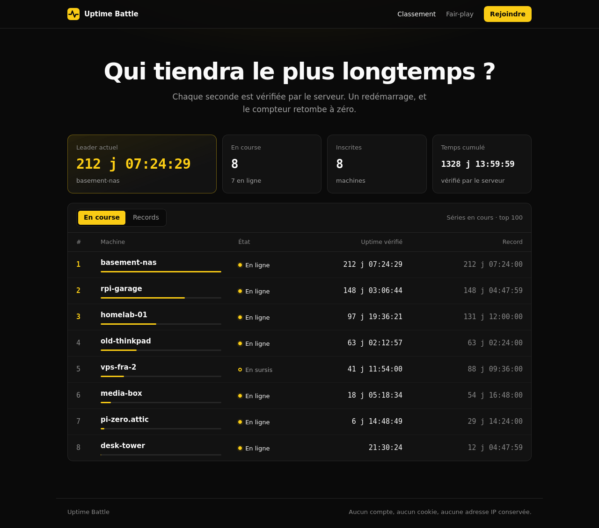

# Uptime Battle

An online game: install an agent on your machine and climb the leaderboard of the longest uptimes. One reboot and your counter drops back to zero.

The project has two parts:

- The agent: a static Go binary of about 6 MB, with no dependencies and no privileges. It reads `/proc/uptime` and the kernel boot id, nothing else.
- The web application: a Go binary with an SQLite database, shipped in a `scratch` image that also contains the agent binaries it distributes.

The web interface is in French.

## Deployment

### Requirements

- A Linux server with Docker and Docker Compose.
- A domain name pointing to the server.
- Ports 80/tcp, 443/tcp and 443/udp open. Caddy uses them to serve the site and to obtain the TLS certificate.

### Start the server

From the root of the repository:

    UB_DOMAIN=battle.example.org docker compose up -d --build

To avoid typing the domain every time, put it in a `.env` file next to `docker-compose.yml`:

    UB_DOMAIN=battle.example.org

Then run `docker compose up -d --build` alone.

Check that the site responds:

    curl https://battle.example.org/healthz

The answer must be `ok`. To read the logs:

    docker compose logs -f app

### Publish the agent image (optional)

This step is only needed if you want to offer the Docker install method to players. Build and push the image, then set `UB_AGENT_IMAGE` so that the install page shows its name:

    docker build -f Dockerfile.agent -t registry.example.org/uptime-battle-agent .
    docker push registry.example.org/uptime-battle-agent

Add this line to the `.env` file and run `docker compose up -d` again:

    UB_AGENT_IMAGE=registry.example.org/uptime-battle-agent

### Update

Get the new sources, then rebuild:

    docker compose up -d --build

Players are not penalized: the time the server was down is removed from the silence of each machine. A reboot that happened during the downtime is still detected.

### Backup

All the data is in one SQLite database, in the `data` volume. It also holds the secret used to sign challenges, so keep backups private.

Stop the application first, so that the copy is consistent. The volume name is prefixed with the Compose project name, which is the name of the directory by default:

    docker compose stop app
    docker run --rm -v uptime-battle_data:/data:ro -v "$PWD":/backup alpine tar czf /backup/uptime-battle-data.tar.gz -C /data .
    docker compose start app

### Running without Docker

Build the binary with `make server` and run `bin/server` behind a TLS reverse proxy. Set `UB_PUBLIC_URL`, `UB_TRUSTED_HOPS`, `UB_DB` and `UB_DOWNLOAD_DIR`.

The download directory must contain the agent binaries and their checksums, because the install script fetches them from there:

    uptime-battle-agent-linux-amd64
    uptime-battle-agent-linux-arm64
    uptime-battle-agent-linux-armv7
    SHA256SUMS

## Environment variables

### Docker Compose

- `UB_DOMAIN`: required. Domain of the site. It is used by Caddy and to build `UB_PUBLIC_URL`.
- `UB_AGENT_IMAGE`: optional. See the server variables below.

`docker-compose.yml` sets `UB_PUBLIC_URL` to `https://` followed by the domain, and `UB_TRUSTED_HOPS` to 1 for Caddy. To change any other server variable, add it to the `environment` section of the `app` service.

### Server

- `UB_PUBLIC_URL`: public URL of the site, used in the install commands. An `https://` URL enables HSTS. Default: `http://localhost:8080`.
- `UB_TRUSTED_HOPS`: number of reverse proxies in front of the application. It must be exact, otherwise `X-Forwarded-For` can be forged and the per-IP limits can be bypassed. Default: `0`.
- `UB_MAX_GAP`: how long a machine can stay silent before it loses its streak. Must be at least `1m`. Default: `15m`.
- `UB_POW_BITS`: difficulty of the proof of work at enrolment, from 0 to 40. The default takes about 3 seconds on a PC. Default: `22`.
- `UB_MAX_MACHINES`: maximum number of enrolled machines. Default: `100000`.
- `UB_AGENT_IMAGE`: image name shown on the install page. Default: `uptime-battle-agent:latest`.
- `UB_ADDR`: listen address. Default: `:8080`.
- `UB_DB`: path of the SQLite database. Default: `/data/uptime-battle.db`.
- `UB_DOWNLOAD_DIR`: directory of the agent binaries. Default: `/srv/dl`.

### Agent

- `UB_SERVER`: server URL. Same as `--server`.
- `UB_NAME`: public name of the machine. Same as `--name`.
- `UB_STATE_DIR`: directory of the machine key. Same as `--state-dir`. Default: `/var/lib/uptime-battle` for root, otherwise `$XDG_STATE_HOME/uptime-battle`, or `~/.local/state/uptime-battle` if `XDG_STATE_HOME` is not set.

## Installing the agent on a client

The agent runs on Linux only (amd64, arm64, armv7). The `/install` page of the site shows the commands below with the right URL, ready to copy. In the examples, replace `battle.example.org` with the domain of the server and `NAME` with the name of your machine.

Choose the name carefully. It is public and permanent, and must be 3 to 32 characters among `a-z A-Z 0-9 _ . -`, starting with a letter or a digit. Enrolment solves a small puzzle, so it takes a few seconds.

The agent refuses plain http to a remote server, unless `--insecure-http` is used.

### Method 1: systemd (recommended)

Needs root, `curl` and `sha256sum`. The service starts with the machine and sends a heartbeat every minute. It runs under a dedicated unprivileged user.

    curl -fsSL https://battle.example.org/install.sh | sudo sh -s -- --method systemd --name NAME

To read the logs:

    journalctl -u uptime-battle-agent -f

### Method 2: cron

Needs no root, only `curl`, `sha256sum` and `crontab`. A job in your user crontab sends a heartbeat every 5 minutes.

    curl -fsSL https://battle.example.org/install.sh | sh -s -- --method cron --name NAME

The binary goes to `~/.local/bin` and the key to `~/.local/state/uptime-battle`.

### Method 3: Docker

The container reads the uptime of the host and needs no privileges. The volume keeps the machine key: if you lose it, you lose the identity of the machine.

    docker run -d --name uptime-battle-agent --restart unless-stopped \
      --read-only --cap-drop ALL --security-opt no-new-privileges \
      -e UB_SERVER=https://battle.example.org -e UB_NAME=NAME \
      -v uptime-battle:/var/lib/uptime-battle \
      IMAGE

`IMAGE` is the agent image published by the server operator. It is shown on the `/install` page.

### Method 4: manual

Use this method to review everything before running it. Replace `amd64` with your architecture if needed.

    curl -fsSLO https://battle.example.org/dl/uptime-battle-agent-linux-amd64
    curl -fsSL https://battle.example.org/dl/SHA256SUMS | sha256sum -c --ignore-missing
    chmod +x uptime-battle-agent-linux-amd64
    ./uptime-battle-agent-linux-amd64 enroll --server https://battle.example.org --name NAME
    ./uptime-battle-agent-linux-amd64 run

### Agent commands

- `enroll`: create the machine key and register the machine.
- `run`: send heartbeats until stopped.
- `once`: send one heartbeat and exit.
- `status`: print the local identity and the URL of the machine page.
- `version`: print the version.

To check an installation, run `status` with the state directory of your install method:

    sudo /usr/local/bin/uptime-battle-agent status --state-dir /var/lib/uptime-battle

The page of your machine is at `https://battle.example.org/m/NAME`.

### Uninstall

Deleting the state directory deletes the machine key. The name cannot be used again from a new key while the machine is still registered on the server.

With systemd:

    sudo systemctl disable --now uptime-battle-agent
    sudo rm /etc/systemd/system/uptime-battle-agent.service /usr/local/bin/uptime-battle-agent
    sudo rm -r /var/lib/uptime-battle
    sudo userdel uptime-battle
    sudo systemctl daemon-reload

With cron:

    crontab -l | grep -v uptime-battle-agent | crontab -
    rm ~/.local/bin/uptime-battle-agent
    rm -r ~/.local/state/uptime-battle

With Docker:

    docker rm -f uptime-battle-agent
    docker volume rm uptime-battle

## Anti-cheat

A client on a machine controlled by the player can never be trusted. So the game does not try to protect the agent: it simply does not believe it.

The score is the time observed by the server, with its own clock. The uptime reported by the agent is only used to detect the end of a streak, never to extend a score. A machine that reports 400 days starts at zero.

Attacks and how they are handled:

- Sending a fake uptime: no effect, it does not count in the score.
- Forging a heartbeat: heartbeats are signed with Ed25519, using a key generated on the machine.
- Replaying or preparing heartbeats: each one needs a single-use server challenge, bound to the machine and valid for 60 seconds.
- Speeding up the counter: at most one heartbeat every 30 seconds, and only the server clock counts.
- Hiding a reboot with the original agent: detected through the kernel `boot_id`, an uptime going backwards, or a drift from the server clock.
- One machine under several names: a `boot_id` can only race under one identity.
- Copying the key to two machines: the `boot_id` values alternate, so the streak resets on each heartbeat.
- Mass enrolment: proof of work, per-IP limit, global cap, and fake accounts start from zero anyway.

### What remains possible

A modified agent can report a constant `boot_id` and hide a reboot shorter than 15 minutes. It can also run on a highly available server instead of the announced PC. The cheater must still keep a program online for the whole displayed duration: there is no shortcut in time.

Closing this last door requires hardware attestation. A TPM 2.0 quote signs a reboot counter (`resetCount`) that software cannot forge.

### Accepted trade-offs

- A machine that has already been up for a year starts at zero when it enrolls.
- Sleep or a network outage longer than 15 minutes ends the streak.
- A server outage penalizes nobody: its duration is removed from the silence of the machines. A reboot during the outage is still detected.

## Site security

- The public site is read-only: no accounts, cookies, sessions or forms. There is nothing to steal and no CSRF.
- No IP address is stored. Rate limits live in memory.
- Names are limited to an ASCII character set: no injection, no homoglyphs.
- Strict CSP (`default-src 'none'`, no inline script or style), HSTS, `nosniff`, anti-framing.
- Strict JSON, request bodies limited to 2 KB, parameterized SQL queries, timeouts against slowloris.
- Per-IP rate limits (per /64 in IPv6). Pages serve a snapshot refreshed every 10 seconds, so a traffic peak does not reach the database.
- `install.sh` uses `UB_PUBLIC_URL` and never the `Host` header. The installer verifies the SHA-256 of the binaries.
- Non-root containers, read-only file system, no capabilities, image without a shell.

## Development

    go test ./...
    UB_DB=./data.db UB_DOWNLOAD_DIR=./bin go run ./cmd/server
    go run ./cmd/agent enroll --server http://localhost:8080 --name my-machine --state-dir ./agent
    go run ./cmd/agent run --state-dir ./agent

Project layout:

- `internal/protocol`: contract between the agent and the server (signed messages, proof of work).
- `internal/server/game.go`: the rules of the game, as pure functions.
- `internal/server/store.go`: SQLite.
- `internal/server/server.go`: API and HTTP security.
- `internal/server/web.go`, `internal/server/web/`: pages, templates, CSS.
- `cmd/agent`: the agent.
- `cmd/server`: the server entry point.
